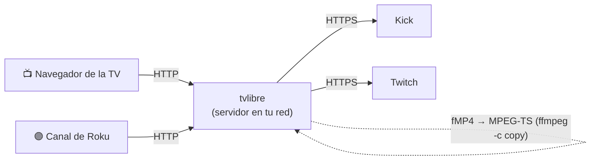

<p align="center">
  
</p>

<p align="center">
  <a href="LICENSE"></a>
  
  
  
  
</p>

<p align="center">
  <a href="README.md">English</a> · <b>Español</b>
</p>

---

**tvlibre convierte tu Smart TV viejo, o tu Roku, en una app para ver Kick y Twitch.**
Muchos televisores traen un sistema que ya no recibe apps: no hay Kick, no hay Twitch y no hay forma de
instalarlos. Pero su navegador integrado sí reproduce video, y un Roku acepta canales propios. tvlibre
aprovecha las dos cosas: un servidor pequeño en tu casa consulta Kick y Twitch, adapta el video y le
entrega a la pantalla una portada pensada para el control remoto.

> [!WARNING]
> **Solo para tu red de casa.** tvlibre rechaza cualquier petición que no venga de una IP privada, pero
> igual **no abras su puerto en el router**: expuesto a internet sería un proxy de video abierto. Para
> verlo fuera de casa usa una VPN como Tailscale.

## Por qué tvlibre

- 📺 **Revive la TV que ya no recibe apps.** Solo necesita un navegador que reproduzca HLS; no hace falta
  ES6 ni nada moderno (probado en Chrome 39, de 2014).
- 🟣 **Y también un canal para Roku.** La misma portada en el reproductor nativo del Roku, conectado por HDMI.
- 🔴 **Lo que importa, arriba.** "En vivo ahora" con tus canales que estén transmitiendo, y debajo sus
  streams anteriores, mezclados por fecha.
- 🔍 **Busca y sigue streamers desde el control.** Escribe un nombre, mira quién está en vivo en Kick y Twitch y
  agrégalo a tu portada (o quítalo) sin tocar el servidor.
- 🧭 **"También en vivo".** Una fila con otros directos en español de las mismas categorías que tus canales.
- 💬 **El chat al lado del video**, en vivo y también en los anteriores, sincronizado con el segundo que estás
  viendo. Solo lectura, y se muestra u oculta con un botón.
- ⏯️ **Retoma donde ibas.** Los anteriores se pueden adelantar y, si los dejas a medias, siguen donde quedaste,
  en la TV o en el Roku.
- 🔆 **Brillo propio**, por si las apps de tu TV lo fuerzan al máximo. 1080p por defecto y 720p a un botón.
- 🪶 **Nada que instalar en Python.** El servidor usa solo la biblioteca estándar más `ffmpeg`.

## Cómo funciona



1. **Instala el servidor** en un equipo de tu red que quede encendido (un Linux, un NAS, una Raspberry).
2. **Pon tus canales** de Kick y Twitch en su configuración.
3. **Ábrelo en la pantalla:** en el navegador de la TV, o instala el canal en tu Roku.

## Arranque rápido: el servidor

**Requisitos:** Python 3.10 o superior y `ffmpeg`, que solo hace falta para los anteriores de Twitch (se
convierten al vuelo de fMP4 a MPEG-TS, sin recodificar). En Debian/Ubuntu:

```bash
sudo apt install -y python3 ffmpeg git
sudo git clone https://github.com/Jdrg4/tvlibre /opt/tvlibre
sudo mkdir -p /etc/tvlibre /var/lib/tvlibre
sudo cp /opt/tvlibre/config.example.json /etc/tvlibre/config.json
sudo chown "$USER" /var/lib/tvlibre
sudo nano /etc/tvlibre/config.json          # tus canales y "state_path": "/var/lib/tvlibre/state.json"
sudo cp /opt/tvlibre/deploy/tvlibre@.service /etc/systemd/system/
sudo systemctl daemon-reload
sudo systemctl enable --now "tvlibre@$USER"
```

¿Solo quieres probarlo? Copia `config.example.json` a `config.local.json`, pon canales reales y corre
`python3 -m tvlibre --config config.local.json`.

### Configuración

```json
{
  "port": 8099,
  "state_path": "/var/lib/tvlibre/state.json",
  "vods_per_channel": 20,
  "default_quality": 1080,
  "channels": [
    {"platform": "kick", "slug": "nombre_del_canal"},
    {"platform": "twitch", "slug": "nombre_del_canal"}
  ]
}
```

- `slug` es el nombre del canal en su URL (`kick.com/<slug>`, `twitch.tv/<slug>`). Puedes poner varios de
  cada plataforma.
- `state_path` es donde se guardan el brillo, los puntos de retomar y los canales que sigas desde la pantalla,
  compartidos entre la TV y el Roku. `channels` es solo la lista inicial: una vez que sigues o dejas de seguir
  a alguien desde la pantalla, manda la de `state_path`.

## En la TV (navegador)

Abre `http://<ip-del-servidor>:8099/` en el navegador de la TV y, si lo permite, guárdala como favorito o
página de inicio.

**¿Sirve en mi TV?** Abre `http://<ip-del-servidor>:8099/diagnostico`. Esa página muestra qué soporta el
navegador, registra los códigos de las teclas de tu control y, con **Probar video**, reproduce un directo y
un anterior y prueba el adelanto. Si los videos salen OK, tvlibre funciona en tu TV.

## En el Roku (canal propio)

El canal vive en [`roku/`](roku/) y se instala en modo desarrollador: no pasa por la tienda de Roku.

1. **Activa el modo desarrollador.** Con el control, en la pantalla de inicio: **Inicio ×3, Arriba ×2,
   Derecha, Izquierda, Derecha, Izquierda, Derecha**. Elige *Enable installer and restart*, acepta y crea
   una contraseña de desarrollador.
2. **Deja que la red llegue al Roku.** En **Configuración → Sistema → Configuración avanzada del sistema →
   Control por aplicaciones móviles → Acceso a la red**, elige **Permisivo** y reinicia el Roku. En modo
   *Limitado*, el instalador web rechaza la conexión aunque el modo desarrollador diga que está activo.
3. **Arma el canal** apuntando a tu servidor:

   ```bash
   python3 roku/build.py http://<ip-del-servidor>:8099      # deja roku/dist/tvlibre-roku.zip
   ```

4. **Instálalo:** abre `http://<ip-del-roku>` en el navegador del PC, entra con `rokudev` y tu contraseña,
   sube el zip y pulsa **Install with zip**. El canal queda como "tvlibre" en tu lista.

Para reinstalar después de un cambio, desde la terminal (te pide la contraseña):

```bash
curl --digest -u rokudev -F "mysubmit=Install" -F "archive=@roku/dist/tvlibre-roku.zip" http://<ip-del-roku>/plugin_install
```

> [!NOTE]
> Un canal en modo desarrollador se queda instalado, pero el Roku admite uno solo a la vez. Los canales
> "beta" de Roku no sirven de atajo: exigen un `.pkg` firmado, y ese `.pkg` lo genera el mismo instalador del
> modo desarrollador.

## Control remoto

| Dónde | TV (navegador) | Roku | Hace |
|---|---|---|---|
| Portada | Flechas | Flechas | Moverse entre tarjetas y filas |
| Portada | OK | OK | Abrir el directo o el anterior |
| Portada | ↑ hasta "🔍 Canales" y OK | `*` | Buscar canales, seguir o dejar de seguir |
| Portada | ← → sobre el ☀ | ↑ desde la primera fila, luego ← → | Bajar o subir el brillo |
| Reproductor | ← → (mantener: 30 s y 60 s) | ← → (mantener acelera hasta 5 min por paso) · ⏪ ⏩ 10 min | Retroceder o adelantar |
| Reproductor | OK | ⏯ | Pausa |
| Reproductor | ↑ ↓ | ↑ ↓ | Subir o bajar el brillo |
| Reproductor | C, botón rojo o "💬 Chat" | OK | Mostrar u ocultar el chat (en el Roku, `*` lo toma el sistema durante el video) |
| Reproductor | Botón de calidad (puntero) | ↺ (menú) | Cambiar entre 1080p y 720p |
| Portada y reproductor | — | ↑↑ en la portada o ↺ en el reproductor | Temporizador de apagado: no, 5 a 120 min. Un minuto antes avisa y cualquier botón lo cancela |
| Reproductor | Atrás | Atrás | Volver a la portada (guarda dónde ibas) |

En la TV también funciona el puntero (la "manito"): clic en tarjetas, en las flechas ‹ › de cada fila, en
−/+ del brillo y en los botones del reproductor.

## Seguridad

| Control | Qué pasa |
|---|---|
| **Solo IP privadas** | Se rechaza cualquier petición que no venga de 10/8, 172.16/12, 192.168/16, loopback o 100.64/10 (Tailscale). |
| **Solo por IP** | tvlibre atiende solo si se entra por `http://192.168.x.x:8099/` o `localhost`, nunca por un nombre de dominio: así ninguna web abierta en otro navegador de tu casa puede usarlo (DNS rebinding). |
| **Escrituras con JSON** | Los `POST` exigen `Content-Type: application/json`, lo que obliga a un preflight CORS que el servidor no contesta. |
| **Imágenes de hosts conocidos** | El proxy de miniaturas solo pide a los CDN de Kick y Twitch. |

## Por dentro

- **Kick en vivo:** la pantalla lo pide directo a la CDN de Kick, sin cargar el servidor.
- **Twitch en vivo y los anteriores:** pasan por tvlibre, que reescribe cada playlist HLS con URLs absolutas
  y sin las etiquetas que un reproductor viejo no entiende.
- **Anteriores de Twitch:** vienen en fMP4 y tvlibre convierte cada segmento a MPEG-TS con
  `ffmpeg -c copy`, como máximo 3 a la vez.
- **Chat:** en vivo, el de Kick sale de su API de mensajes y el de Twitch de su IRC público, en modo anónimo; la
  conexión se cierra sola si nadie lo mira. En los anteriores se pide por el segundo del video.
- **Tramos silenciados:** Twitch quita el audio de partes de sus anteriores por derechos de autor. tvlibre los
  detecta (segmentos `-muted`) y la barra del reproductor lo avisa, para que no parezca una falla.
- **Roku:** el canal (BrightScript + SceneGraph) usa la misma API (`/api/home`, `/play/<id>.m3u8`) y el
  reproductor nativo del Roku.

## Aviso

tvlibre usa las **APIs públicas no oficiales** de Kick y Twitch, las mismas que usan sus sitios web, así que
puede dejar de funcionar si cambian. No tiene relación con Kick, Twitch, Roku ni ningún fabricante de
televisores. Es para uso personal: no hay inicio de sesión, así que el contenido solo para suscriptores no
aparece, y no quita la publicidad que las plataformas meten en el stream.

## Limitaciones conocidas

- Un enlace `/play/<id>` con un id inexistente fuerza a recargar la portada: no tiene límite de frecuencia.
- El canal de Roku necesita el modo desarrollador: no está en la tienda de canales.

## Contribuir

Issues y pull requests son bienvenidos. Empieza por [CLAUDE.md](CLAUDE.md): es la guía del proyecto
(arquitectura, comandos, lo medido en televisores reales y la lista de comprobaciones antes de abrir un PR),
y sirve uses o no un agente de código.

```bash
python3 -m unittest discover -s tests -v
```

Si tvlibre te sirve, **una ⭐ ayuda mucho**: es como otros lo encuentran.

## Licencia

[MIT](LICENSE): úsalo, modifícalo y compártelo como quieras.
