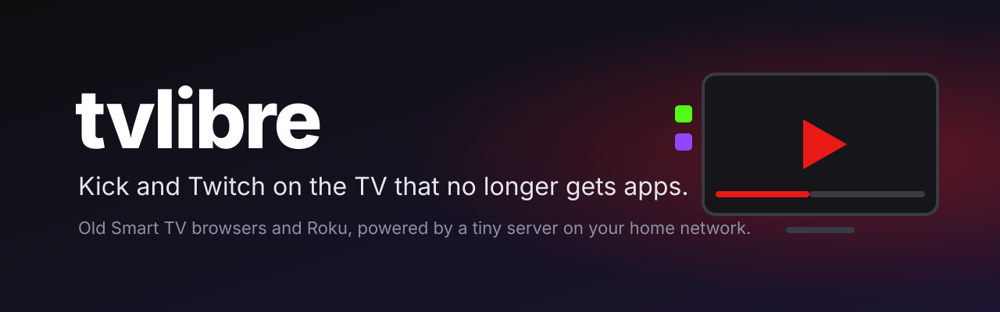
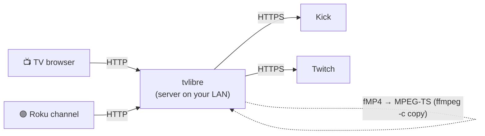

<p align="center">
  
</p>

<p align="center">
  <a href="LICENSE"></a>
  
  
  
  
</p>

<p align="center">
  <b>English</b> · <a href="README.es.md">Español</a>
</p>

---

**tvlibre turns your old Smart TV, or your Roku, into an app to watch Kick and Twitch.**
Many TVs ship a system that no longer gets apps: no Kick, no Twitch, no way to install them. But their
built-in browser still plays video, and a Roku accepts your own channels. tvlibre uses both: a small server
at home talks to Kick and Twitch, adapts the video, and hands the screen a remote-friendly home page.

> [!WARNING]
> **Home network only.** tvlibre rejects any request that doesn't come from a private IP, but still
> **never forward its port on your router**: exposed to the internet it would be an open video proxy. To
> watch away from home, use a VPN such as Tailscale.

## Why tvlibre

- 📺 **Revives the TV that stopped getting apps.** All it needs is a browser that plays HLS; no ES6, nothing
  modern (tested on Chrome 39, from 2014).
- 🟣 **Plus a Roku channel.** The same home page on the Roku's native player, plugged in over HDMI.
- 🔴 **What matters, on top.** "Live now" with your channels that are streaming, and below them their past
  broadcasts, mixed by date.
- ⏯️ **Picks up where you left off.** Past broadcasts can be seeked and, if you stop halfway, they resume
  where you were, on the TV or on the Roku.
- 🔆 **Its own brightness control**, in case your TV's apps force it to the max. 1080p by default, 720p one
  button away.
- 🪶 **Nothing to pip install.** The server uses only the Python standard library plus `ffmpeg`.

## How it works



1. **Install the server** on an always-on machine in your home (a Linux box, a NAS, a Raspberry Pi).
2. **Add your channels** from Kick and Twitch to its config.
3. **Open it on the screen:** in the TV's browser, or install the channel on your Roku.

## Quick start: the server

**Requirements:** Python 3.10 or newer and `ffmpeg`, which is only needed for Twitch past broadcasts (they
are remuxed on the fly from fMP4 to MPEG-TS, no re-encoding). On Debian/Ubuntu:

```bash
sudo apt install -y python3 ffmpeg git
sudo git clone https://github.com/Jdrg4/tvlibre /opt/tvlibre
sudo mkdir -p /etc/tvlibre /var/lib/tvlibre
sudo cp /opt/tvlibre/config.example.json /etc/tvlibre/config.json
sudo chown "$USER" /var/lib/tvlibre
sudo nano /etc/tvlibre/config.json          # your channels and "state_path": "/var/lib/tvlibre/state.json"
sudo cp /opt/tvlibre/deploy/tvlibre@.service /etc/systemd/system/
sudo systemctl daemon-reload
sudo systemctl enable --now "tvlibre@$USER"
```

Just trying it out? Copy `config.example.json` to `config.local.json`, put real channels in it and run
`python3 -m tvlibre --config config.local.json`.

### Configuration

```json
{
  "port": 8099,
  "state_path": "/var/lib/tvlibre/state.json",
  "vods_per_channel": 20,
  "default_quality": 1080,
  "channels": [
    {"platform": "kick", "slug": "channel_name"},
    {"platform": "twitch", "slug": "channel_name"}
  ]
}
```

- `slug` is the channel name in its URL (`kick.com/<slug>`, `twitch.tv/<slug>`). You can add several per
  platform.
- `state_path` is where brightness and resume points are stored, shared by the TV and the Roku.

## On the TV (browser)

Open `http://<server-ip>:8099/` in the TV's browser and, if it lets you, save it as a bookmark or home page.

**Will it work on my TV?** Open `http://<server-ip>:8099/diagnostico`. It shows what the browser supports,
logs your remote's key codes and, with **Probar video**, plays a live stream and a past broadcast and tests
seeking. If the videos play, tvlibre works on your TV.

## On the Roku (own channel)

The channel lives in [`roku/`](roku/) and is installed in developer mode: it doesn't go through the Roku
store.

1. **Enable developer mode.** With the remote, on the home screen: **Home ×3, Up ×2, Right, Left, Right,
   Left, Right**. Choose *Enable installer and restart*, accept, and set a developer password.
2. **Let the network reach the Roku.** In **Settings → System → Advanced system settings → Control by mobile
   apps → Network access**, choose **Permissive** and restart the Roku. In *Limited* mode the web installer
   refuses connections even though developer mode says it's on.
3. **Build the channel** pointing at your server:

   ```bash
   python3 roku/build.py http://<server-ip>:8099      # writes roku/dist/tvlibre-roku.zip
   ```

4. **Install it:** open `http://<roku-ip>` in your computer's browser, log in as `rokudev` with your
   password, upload the zip and press **Install with zip**. The channel shows up as "tvlibre" in your list.

To reinstall after a change, from a terminal (it asks for the password):

```bash
curl --digest -u rokudev -F "mysubmit=Install" -F "archive=@roku/dist/tvlibre-roku.zip" http://<roku-ip>/plugin_install
```

> [!NOTE]
> A developer-mode channel stays installed, but the Roku holds only one at a time. Roku "beta" channels are
> not a shortcut: they require a signed `.pkg`, and that `.pkg` is produced by the same developer-mode
> installer.

## Remote control

| Where | TV (browser) | Roku | Does |
|---|---|---|---|
| Home | Arrows | Arrows | Move between cards and rows |
| Home | OK | OK | Open the live stream or past broadcast |
| Home | ← → on the ☀ | ↑ from the first row, then ← → | Lower or raise brightness |
| Player | ← → (hold: 30 s and 60 s) | ← → (hold speeds up to 5 min per step) · ⏪ ⏩ 10 min | Seek back or forward |
| Player | OK | OK / ⏯ | Pause |
| Player | ↑ ↓ | ↑ ↓ | Raise or lower brightness |
| Player | Quality button (pointer) | `*` | Switch between 1080p and 720p |
| Player | Back | Back | Back to home (remembers where you were) |

On the TV the pointer works too: click cards, each row's ‹ › arrows, the brightness −/+ and the player's
buttons.

## Security

| Control | What happens |
|---|---|
| **Private IPs only** | Any request not coming from 10/8, 172.16/12, 192.168/16, loopback or 100.64/10 (Tailscale) is rejected. |
| **By IP only** | tvlibre only answers when reached as `http://192.168.x.x:8099/` or `localhost`, never through a domain name, so no website open in another browser at home can use it (DNS rebinding). |
| **JSON writes** | `POST`s require `Content-Type: application/json`, which forces a CORS preflight the server never answers. |
| **Known image hosts** | The thumbnail proxy only fetches from Kick's and Twitch's CDNs. |

## Under the hood

- **Kick live:** the screen fetches it straight from Kick's CDN, without loading the server.
- **Twitch live and past broadcasts:** go through tvlibre, which rewrites every HLS playlist with absolute
  URLs and without the tags an old player doesn't understand.
- **Twitch past broadcasts:** come as fMP4, and tvlibre remuxes each segment to MPEG-TS with
  `ffmpeg -c copy`, at most 3 at a time.
- **Roku:** the channel (BrightScript + SceneGraph) uses the same API (`/api/home`, `/play/<id>.m3u8`) and
  the Roku's native player.

## Disclaimer

tvlibre uses Kick's and Twitch's **unofficial public APIs**, the same ones their websites use, so it can
break if they change. It is not affiliated with Kick, Twitch, Roku or any TV maker. It's for personal use:
there's no login, so subscriber-only content doesn't show up, and it does not strip the ads the platforms
put in the stream.

## Known limitations

- A `/play/<id>` link with an unknown id forces a home refresh: it is not rate-limited.
- The Roku channel needs developer mode: it isn't in the channel store.

## Contributing

Issues and pull requests are welcome. Start with [CLAUDE.md](CLAUDE.md): it's the project guide
(architecture, commands, what was measured on real TVs, and the checklist before opening a PR), useful
whether or not you use a coding agent.

```bash
python3 -m unittest discover -s tests -v
```

If tvlibre is useful to you, **a ⭐ helps a lot**: it's how others find it.

## License

[MIT](LICENSE): use it, change it and share it as you like.
